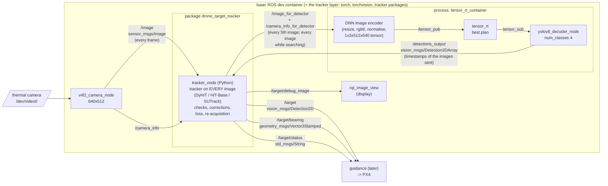
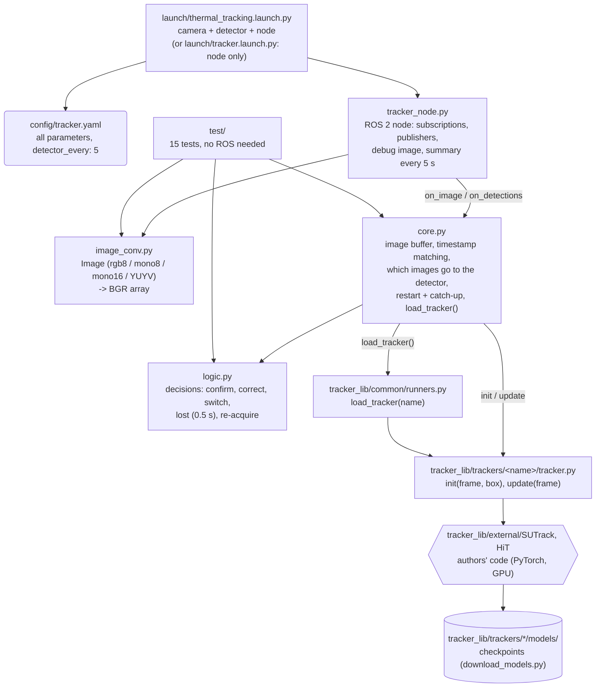
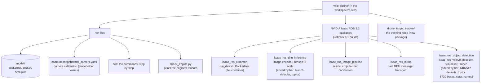

# Architecture of the thermal YOLO workspace (Isaac ROS 3.2)

Four diagrams: **the ROS 2 graph as it runs today**, **the graph with the tracking node** (package
`drone_target_tracker`), **inside that package**, and **what the repository contains**. They are Mermaid diagrams: GitHub draws them; in VS Code install the extension *Markdown
Preview Mermaid Support* and open this file with Ctrl+Shift+V. On the Jetson, `ros2 run rqt_graph rqt_graph` (in the
container, while everything runs) draws the live graph.

Reading the diagrams: rectangles are ROS 2 nodes (running programs), arrows are topics (labelled with the topic name
and the message type), the big boxes are processes that host several nodes.

## 1. The ROS 2 graph today

Started with the `v4l2_camera` command and `yolov8_tensor_rt.launch.py` (see `doc`), all inside the Isaac ROS
development container (`run_dev.sh`).

```mermaid
flowchart LR
    cam[/"thermal camera<br/>/dev/video0"/]

    subgraph container["Isaac ROS dev container (Docker)"]
        v4l2["v4l2_camera_node<br/>640x512 frames<br/>calibration: thermal_camera.yaml"]

        subgraph trtc["process: tensor_rt_container (several nodes, zero-copy NITROS messages)"]
            direction LR
            subgraph enc["DNN image encoder (yolov8_encoder)"]
                direction LR
                resize["resize_node<br/>640x512 -> 640x512"] --> conv["image_format_converter_node<br/>-> rgb8"] --> crop["crop_node"] --> i2t["image_to_tensor<br/>0..1"] --> norm["normalize_node<br/>mean 0, std 1"] --> i2p["interleaved_to_planar_node<br/>HWC -> CHW"] --> reshape["reshape_node<br/>1x3x512x640"]
            end
            trt["tensor_rt (TensorRTNode)<br/>runs model/best.plan"]
            dec["yolov8_decoder_node<br/>score from 0.25, NMS 0.45<br/>(num_classes not set: 80, see note)"]
        end

        vis["yolov8_visualizer (Python)<br/>draws the boxes<br/>matches image + detections by timestamp"]
        rqt["rqt_image_view<br/>(display)"]
    end

    cam --> v4l2
    v4l2 -- "/image<br/>sensor_msgs/Image" --> resize
    v4l2 -- "/camera_info<br/>sensor_msgs/CameraInfo" --> resize
    reshape -- "/tensor_pub<br/>TensorList (images)" --> trt
    trt -- "tensor_sub<br/>TensorList (output0: 1x8x6720)" --> dec
    dec -- "detections_output<br/>vision_msgs/Detection2DArray" --> vis
    v4l2 -- "/image" --> vis
    vis -- "yolov8_processed_image<br/>sensor_msgs/Image" --> rqt
```

What each detection in `detections_output` holds: box centre x, y and size in pixels of the 640x512 image, class id
`"0"` = car, `"1"` = bus, `"2"` = truck, `"3"` = motorcycle, a score, and the **timestamp of the camera image** it
was computed from.

**Note on `num_classes`:** the decoder's `num_classes` parameter defaults to 80 and the launch does not set it, so the
decoder reads 80 class scores for a model that has 4, past the end of the output. Fix: add `'num_classes': 4` to the
decoder's parameters in `yolov8_tensor_rt.launch.py`.

## 2. With the tracking node (drone_target_tracker)

Started with `ros2 launch drone_target_tracker thermal_tracking.launch.py`. The package is written (not run on the
Jetson yet). The detector nodes are the same as in diagram 1, but the encoder now reads the images that tracker_node
forwards: **every 5th image while tracking** (`detector_every`), **every image while searching**. NVIDIA's and her
files are not modified; the launch also sets the decoder's `num_classes` to 4.

- tracker_node publishes `/target` on every image while tracking; `/target/status` says `tracking` or `searching`.
- Each detection message comes back with the timestamp of its image; tracker_node compares it with the tracker's
  box **on that image** (it keeps the last images in a buffer), and restarts the tracker on it when needed.
- `detector_every: 0` gives the old wiring: the encoder reads `/image`, the detector runs on every image and every
  detection message is used. Started with the workspace's own launch + `tracker.launch.py`, the detector also reads
  `/image` (no GPU saved), but tracker_node uses only the detections of the images it forwarded.

## 3. Inside drone_target_tracker (who calls whom)

Only `tracker_node.py` uses ROS. `core.py` and `logic.py` are plain Python: they are tested, and can be reused in an
offline test bench, without ROS.

## 4. What the repository contains

