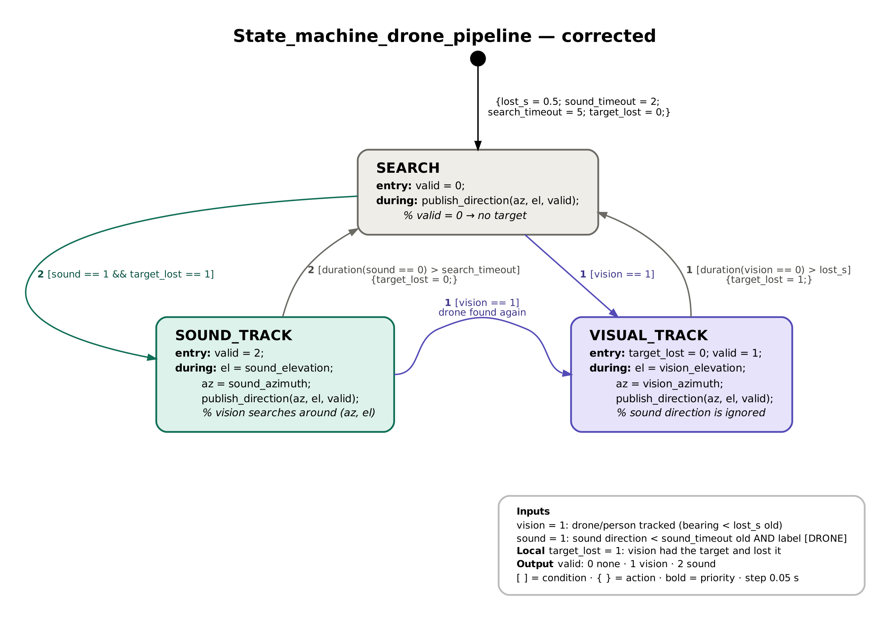

# dalbd_fusion — sound / vision fusion state machine

ROS 2 (Humble) package that implements **State_machine_drone_pipeline**:
vision always wins; when vision loses the target, the sound direction is used to find it again.



| State | entry | during | output `valid` |
|---|---|---|---|
| SEARCH | `valid = 0` | publish nothing (NaN) | 0 |
| VISUAL_TRACK | `target_lost = 0; valid = 1` | az, el = vision (sound ignored) | 1 |
| SOUND_TRACK | `valid = 2` | az, el = sound; `/fused/search_cue` for vision | 2 |

| From → To | Priority | Condition {action} |
|---|---|---|
| SEARCH → VISUAL_TRACK | 1 | `[vision == 1]` |
| SEARCH → SOUND_TRACK | 2 | `[sound == 1 && target_lost == 1]` |
| VISUAL_TRACK → SEARCH | 1 | `[duration(vision == 0) > lost_s] {target_lost = 1}` |
| SOUND_TRACK → VISUAL_TRACK | 1 | `[vision == 1]` |
| SOUND_TRACK → SEARCH | 2 | `[duration(sound == 0) > search_timeout] {target_lost = 0}` |

`vision = 1`: tracker status "tracking" and bearing younger than `vision_timeout_s` (0.3 s).
`sound = 1`: `/drone_warning` says `level_name: DRONE` with a direction, younger than `sound_timeout_s` (2 s).

## Files

```
dalbd_fusion/
├── dalbd_fusion/
│   ├── state_machine.py        the chart (pure Python, no ROS) — the only file with the logic
│   ├── state_machine_node.py   ROS 2 node: joins vision domain 0 + sound domain 42, publishes /fused/*
│   ├── sound_parsing.py        /drone_warning parsing, x y z -> az el, array -> camera frame
│   ├── fake_sound_node.py      simulated sound pipeline (no drone, no UMA-8)
│   └── state_report.py         CSV log -> state table + timeline PNG
├── config/fusion.yaml          lost_s, timeouts, rules, calibration offsets, topics
├── launch/fusion.launch.py
├── test/test_state_machine.py  one test per transition (no ROS needed)
└── docs/                       architecture + state machine pictures
```

## Topics

| Topic | Domain | Type | Content |
|---|---|---|---|
| `/target/status` (in) | 0 | std_msgs/String | `tracking` / `searching` |
| `/target/bearing` (in) | 0 | geometry_msgs/Vector3Stamped | x = az, y = el (rad, camera frame) |
| `/drone_warning` (in) | 42 | std_msgs/String JSON | `{level_name: CLEAR\|DRONE, id, prob, x, y, z, azimuth_deg, elevation_deg}` |
| `/target/direction` (in, optional) | 42 | std_msgs/String JSON | `{drone, targets: [...]}`: best `drone_prob` target (only if `sound_direction_topic` is set) |
| `/fused/bearing` (out) | 0 + 42 | geometry_msgs/Vector3Stamped | x = az, y = el (rad, camera frame), z = valid |
| `/fused/state` (out) | 0 + 42 | std_msgs/String | JSON: state, valid, az_deg, el_deg, vision, sound, target_lost |
| `/fused/search_cue` (out) | 0 | geometry_msgs/Vector3Stamped | sound direction while SOUND_TRACK (for re-acquisition) |

Log: `/workspaces/isaac_ros-dev/fusion_logs/fusion_<date>.csv` (one row per 0.05 s step).

---

## 1. Install (once)

The package lives in `DALBD/dalbd_fusion`. **JETSON container**:
```bash
cd /workspaces/isaac_ros-dev
colcon build --symlink-install --packages-select dalbd_fusion
source install/setup.bash
ros2 pkg executables dalbd_fusion
```

## 2. Level 0 — logic tests (no ROS, 1 s)

**JETSON container**
```bash
cd /workspaces/isaac_ros-dev/src/DALBD/dalbd_fusion
python3 -m pytest -q test                       # expect: 24 passed
```

## 3. Level 1 — video + fake sound (no camera, no drone, no UMA-8)

Scenario: the video target is tracked, the camera is "covered" at 10–15 s and 25–35 s, the fake sound hears a
drone at az +10° the whole time. Expected: VISUAL → SEARCH → SOUND → VISUAL → SEARCH → SOUND → VISUAL.

**JETSON container — T1 (vision pipeline)**
```bash
source /workspaces/isaac_ros-dev/install/setup.bash
ros2 launch drone_target_tracker thermal_tracking.launch.py
```

**JETSON container — T2 (fusion + fake sound, waits for the video to start)**
```bash
source /workspaces/isaac_ros-dev/install/setup.bash
ros2 launch dalbd_fusion fusion.launch.py fake_sound:=true schedule:="0-60:10/0"
```

**JETSON container — T3 (video as camera, with camera blackouts)**
```bash
source /workspaces/isaac_ros-dev/install/setup.bash
cd /workspaces/isaac_ros-dev/tools/net_camera
python3 video_test_node.py --ros-args -p video:=<path to a test video .mp4> -p blackout:="10-15,25-35"
```

**JETSON container — T4 (live state)**
```bash
source /workspaces/isaac_ros-dev/install/setup.bash
ros2 topic echo /fused/state
```

After the video ends: Ctrl-C in T2, then **JETSON container — T4**:
```bash
ros2 run dalbd_fusion state_report       # table + fusion_<date>_timeline.png
```

## 4. Level 2 — real test

Use the run scripts or the manual terminals in the main `DALBD/README.md` (sections 3 and 4).
Walk: in view → out of view (drone sound ON) → back in view → leave (sound OFF).
Expected: `SEARCH → VISUAL_TRACK → SEARCH → SOUND_TRACK → VISUAL_TRACK → SEARCH`, then `ros2 run dalbd_fusion state_report`.

## 5. Calibration (camera ↔ UMA-8)

Stand in the middle of the image with the phone ON, then walk slowly left and right. In `state_report`:
- the vision–sound gap is constant → set `sound_yaw_offset_deg` to its median;
- the sound azimuth moves the opposite way to vision → set `sound_az_sign` to `1.0`.

```bash
ros2 launch dalbd_fusion fusion.launch.py sound_yaw_offset_deg:=3.5 sound_az_sign:=-1.0
```
Then write the values into `config/fusion.yaml`.

## Options

| Parameter | Default | Effect |
|---|---|---|
| `sound_requires_loss` | true | false: sound alone can start SOUND_TRACK at start-up (removes `&& target_lost == 1`) |
| `require_drone_label` | true | false: any sound direction counts, even without `level_name: DRONE` |
| `sound_direction_topic` | `""` | `""`: direction from `/drone_warning`; `/target/direction`: raw targets list |
| `vision_domain` / `sound_domain` | 0 / 42 | launch arguments |

## RViz view (fusion_viz)

`ros2 run dalbd_fusion fusion_viz` (run with `ROS_DOMAIN_ID=42`, where `/fused/state` and `/drone_warning` both exist)
publishes `/fusion/viz` (MarkerArray, frame `camera`: x forward, y left, z up) and the static TF `camera -> odas`.

| Marker | Meaning |
|---|---|
| grey pyramid | camera field of view (46.2 x 37.7 deg) |
| yellow arrow + label | live sound direction (best DRONE target): LEFT/RIGHT, UP/DOWN, IN/OUT OF VIEW, raw x y z |
| grey ball | mirror point (planar array, front/back ambiguity) |
| yellow dots | sound trail, last 3 s |
| blue / green thick arrow | fused output: blue = vision, green = sound |
| big text above | state (SEARCH / VISUAL_TRACK / SOUND_TRACK), source, vision / sound / target_lost |

Layout: `rviz2 -d $(ros2 pkg prefix dalbd_fusion)/share/dalbd_fusion/rviz/dalbd.rviz`
(or copy `rviz/dalbd.rviz` to the laptop). `sound_axes` must match the UMA-8 mounting (same value as the fusion).
